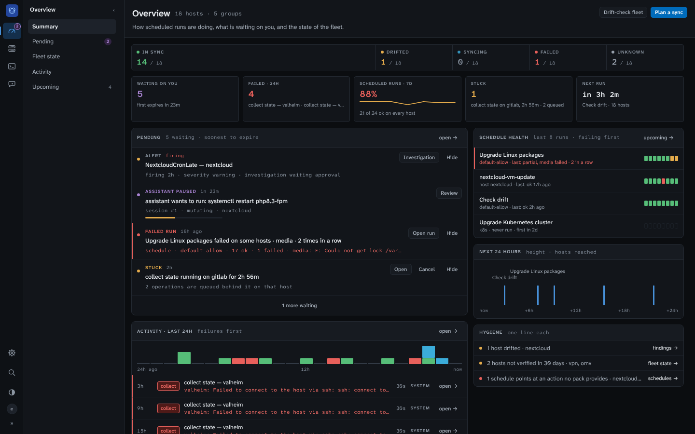

# Overview

**Path:** `/overview` (`/dashboard` and `/` redirect here)

The landing page: how scheduled runs are doing, what is waiting on you, and
the state of the fleet. It is the first zone on the rail, and the only one
whose rail icon carries a badge. The badge counts only what blocks or
expires — assistant approval gates, firing alerts, and one for the discovery
queue when it is non-empty. Failed runs, stuck operations and drift never
inflate it: a badge that says 214 because of drift findings is a badge you
stop reading.

The Overview pane lists five views of the same data. Each is a URL
(`/overview?view=pending` …), and so are the filters inside them
(`?view=pending&lane=failed`, `?view=activity&range=7d&kind=failed`), so any
of them can be deep-linked and the back button undoes a filter.

Scheduled runs come first. A fleet that is configured once rarely drifts;
what goes wrong week to week is the unattended upgrade that failed on one
host, or the schedule that silently stopped running. Drift stays on the page
as one line.

## Summary

The default view.

| Panel | What it shows |
|-------|---------------|
| **Fleet status bar** | in sync · drifted · syncing · failed · unknown, segment width proportional to count. Every segment is a click-through into the hosts list filtered to that status. |
| **Tiles** | Waiting on you · failed runs in the last 24 hours · scheduled runs over 7 days (share that succeeded, with a sparkline) · stuck operations · the next run. Each tile opens the view and filter behind it. |
| **Pending** | The first four items of the queue (see below), soonest to expire first. |
| **Activity · last 24h** | An hourly strip (click a bar for that hour) and the day's events, failures pinned to the top. A failed run shows its host tally (`17 ok · 1 failed`) and the first failing host's reason, taken from the log, with **Investigate with AI**. |
| **Schedule health** | Every schedule with its last eight runs as coloured squares, failing schedules first: "failed 2 times in a row" is the line to act on. |
| **Next 24 hours** | When each schedule fires, mark height = hosts reached. |
| **Hygiene** | One line each: drift (or "drift checking is off"), hosts not verified in 30 days, and schedules whose action no enabled pack provides — the scheduler skips those without a word. |

**Drift-check fleet** (top right) queues a state collection on every host;
**Plan a sync** opens [Plans](operations.md#plans).

## Pending

One queue, typed lanes, sorted by expiry rather than recency. Nothing here
is a message: an item is a decision waiting to be made, and it leaves the
list when the decision is. Click a lane card to filter the list to it.

| Lane | Source | Expires |
|------|--------|---------|
| **Approvals** | Assistant sessions paused at an approval gate; discovered hosts awaiting approval, one item per scan | Gates carry the approval's expiry; discovered hosts do not expire |
| **Failed runs** | One item per schedule whose last finished run failed or partly failed, with how many times in a row, the host tally and the first failing host's reason. Runs started by an alert are included; ad-hoc runs are not. | When the schedule next succeeds |
| **Stuck** | Syncs and action runs `running` for longer than the sync sweeper's threshold (30 min), and how many operations queue behind them on the same host. **Cancel** stops an action run. | When it finishes |
| **Alerts** | Alerts currently firing (Grafana webhook or Alertmanager poll), critical ones marked blocking | "firing" for as long as they fire |
| **Drift** | One informational item when any host is drifted, naming the hosts | never |

Each row goes to the place the decision is made — the run, the session, the
Discovery queue, the alert, Drift. **Hide** removes an item from *this
browser's* queue only; it stays in history and comes back in a new session.
Approval gates cannot be hidden: a hidden gate would still block its
session, and the only honest way off the list is a decision.

Beside the list, **by host** groups the same items per host (several
problems on one host usually share a cause), and **settled · last 24h**
lists what left the queue: approvals approved, rejected or expired, and
alerts resolved.

## Fleet state

Standing condition, not a queue.

- The status bar, then four coverage fractions: hosts that get a Proxmox
  snapshot before changes, hosts with drift checks on, hosts verified in
  the last 30 days, and hosts with a pinned SSH host key. Each names the
  hosts it is missing.
- **Operating systems** from collected facts, with the next stable release
  where one exists, plus kernel versions (oldest first) and the firewall
  backend mix.
- **Resource hot spots** — the busiest hosts by CPU, memory and disk, when
  Grafana/Mimir is configured.
- **Stale hosts**, **by group** (status mix per group, in priority order),
  a small **drift** line with a 14-day sparkline of drifted checks, and
  **modules across the fleet** (sync status per module).

## Activity

Applies, action runs, state collections, alerts and assistant sessions,
failures first. Switch between the last 24 hours and the last 7 days, and
filter by kind (failed, schedule, action, apply, collect, drift, alert, AI)
or by clicking a bar in the hourly strip. **Failing most** lists the same
action failing on the same host more than once; **who started what** counts
events per user. The full history is under [Runs](operations.md#runs).

## Upcoming

- **Next 7 days** — one lane per schedule from midnight today: runs that
  already happened today coloured by outcome, upcoming fires as marks, and a
  box where two schedules touch the same host at overlapping times. Overlap
  uses each schedule's average run time, and the sentence under the
  timeline says how often it happens this week.
- **Scheduled** — every schedule with its cron in words, next run, hosts
  reached, last eight runs and average duration. A schedule whose action no
  enabled pack provides is marked *action missing* and its next run
  *skipped*.
- **Other dates** — CA certificates running out, linking to the group or
  host that deploys them.
- **Integration health** — what the scheduled runs depend on: Proxmox (how
  many schedules snapshot through it), action packs (a failed sync, and how
  many schedules use the pack), Git remotes, Grafana/Mimir/Loki, the AI
  provider and the Prometheus export.

## Endpoints behind it

| Endpoint | Used for |
|----------|----------|
| `GET /api/scheduled-actions` | `next_run_at`, `upcoming_runs` (next 7 days, at most 200) and `recent_runs` (last 8, `?recent_runs=N`) per schedule |
| `GET /api/actions/runs?status=failed,partial&since=…&scheduled=true` | Run lists; every run carries `host_counts` and `first_failure` (host, exit code, reason from the log) |
| `GET /api/dashboard/stuck-operations` | The Stuck lane |
| `GET /api/dashboard/module-status` | Modules across the fleet |
| `GET /api/dashboard/ca-cert-expiries` | Other dates |
| `GET /api/dashboard/drift-trend` | The drift sparkline |
| `GET /api/grafana/fleet/metrics` | Resource hot spots |
